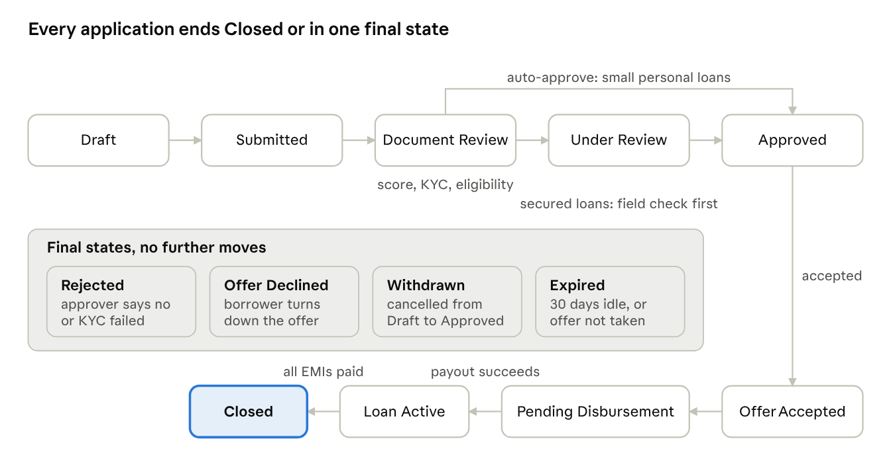
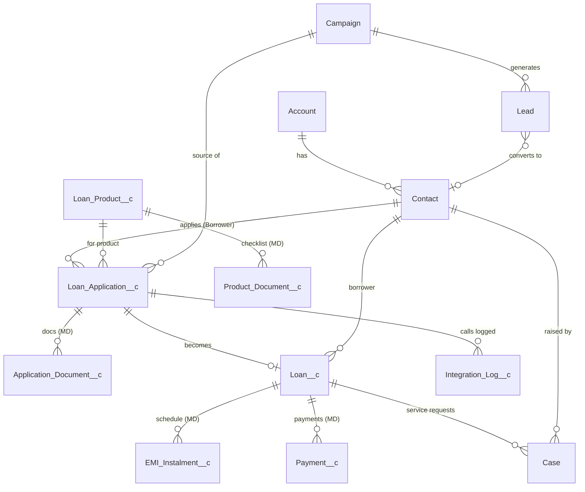

# Loan Application Management System – BRD & Solution Design v2.3

v2.3 · Nov 21, 2026 · This file is the source of truth. The original v2 [Claude Doc](https://claude.ai/artifact/23Zni2f18b3w7BkGGmKvUV) is no longer updated.

This v2 replaces the Nov 10 simplified BRD. It splits the work into a business BRD (Part A, no Salesforce terms) and a Solution Design (Part B, how Salesforce delivers it). Every business rule has an ID (BR-xx), and Part B points back to those IDs. The appendix lists every fix made since v1.

| Part | Sections | Read it for |
| --- | --- | --- |
| A. Business requirements | §1–§9 | What the business needs, rules, acceptance criteria |
| B. Solution design | §10–§21 | Objects, security, toggles, automation, Apex, UI, integrations, build order |
| Traceability | §21 | Which Salesforce feature delivers which requirement |
| Appendices | A: changes from v1 · B: v2.1 decisions · C: v2.2 sales · D: v2.3 org decisions | What changed and why |

Amounts are in ₹ (lakh = 1,00,000; crore = 1,00,00,000).

# Part A – Business Requirements

## 1. Project overview and objectives

LAMS is a lending platform that takes a borrower from application to loan closure in one system: apply, check eligibility, collect documents, approve, disburse, collect EMIs and follow up on overdue loans. It supports four products (Personal, Home, Auto, Small-Business). Products are configured as data, so a fifth product needs no new process. It is a custom app on the Salesforce Platform that also uses Sales Cloud (leads, campaigns), Service Cloud (cases, messaging), Experience Cloud (portal), Agentforce and Data Cloud.

**Business objectives**

| # | Objective | Measured by (§9) |
| --- | --- | --- |
| O1 | Cut time from submission to decision | Average days to decision |
| O2 | Apply credit policy the same way every time | % of decisions that follow the eligibility result or carry a recorded override |
| O3 | Let borrowers self-serve | % of applications and service requests raised through the portal |
| O4 | Never miss an EMI follow-up | % of overdue loans with an officer task within 1 day |
| O5 | Change behaviour without a release | Features switched on or off by configuration alone |
| O6 | Keep a full audit trail | Every status change, decision and external call traceable |

**Project objective (personal).** This is a portfolio project. Each Salesforce capability in §21 must be justified by a requirement in this part; nothing is built only to tick a box.

## 2. Business problem statement

A mid-sized lender handles applications across branches, a website and dealer or DSA partners using spreadsheets, email and a legacy servicing system. That causes five problems:

- **Slow decisions.** Documents arrive by email, nobody knows what is still missing, and an application waits days between hand-offs.
- **Inconsistent credit policy.** Officers apply product limits from memory, and approvals above an officer's authority are not always escalated.
- **No borrower visibility.** Borrowers phone the branch to ask about status, missing documents and EMI dates.
- **Missed collections.** Overdue EMIs are found late, late fees are applied by hand, and there is no early warning.
- **No audit trail.** Partner submissions, bureau checks and payouts leave no reliable record of what was sent, received or retried.

LAMS solves these with one system of record, enforced rules, a borrower portal, automated servicing and logged integrations.

## 3. Scope

**In scope**

| Area | Included |
| --- | --- |
| Origination | Application capture (branch, portal, partner), draft save and resume, submission |
| Credit | Eligibility rules per product, bureau credit score, KYC, risk grade, auto-approve for small personal loans |
| Documents | Per-product checklist, upload, verify or reject with reason |
| Approval | Two-level approval by amount; offer with expiry; accept or decline |
| Secured loans | Field verification for Home and Small-Business loans |
| Disbursement | Payout to borrower or dealer, with retry on failure |
| Servicing | EMI schedule, payment capture and allocation, late fees, overdue buckets, closure |
| Service requests | Statement, prepayment quote, address change, dispute; with escalation |
| Notifications | Email for every key event; SMS when enabled |
| Portal | Apply, upload documents, accept offer, view loans and EMIs, raise requests, AI assistant |
| Integrations | Bureau, KYC, payout, SMS, core banking, partner API, payment callback, legacy status lookup, event stream |
| Analytics | Origination, portfolio and integration dashboards; customer insights |
| AI | Borrower assistant and loan officer assistant (explain and prepare only) |
| Configuration | Feature toggles and tunable values without a release |
| Sales | Callback requests and enquiries as leads, qualification, conversion into a draft application, campaigns for pre-approved top-up offers |

**Out of scope (this version)**

Co-applicants and guarantors · tranche disbursement · loan restructuring · a separate collections team · approval delegation · multi-currency · real (non-mock) external systems · general ledger accounting. The data model must not block any of these later.

## 4. Users, personas and roles

Five business users. Credit Head sits at the top; Loan Officers report to Credit Managers; Operations reports to Credit Head.

| User | Persona and goal | Does | Approval authority |
| --- | --- | --- | --- |
| Loan Officer | Branch officer; wants complete files fast | Qualifies and converts leads, captures applications, chases and verifies documents, confirms documents for secured loans | None; can never approve |
| Credit Manager | Underwriter; wants clean, comparable files | Reviews eligibility and credit, approves or rejects, can reduce the amount | Up to ₹25 lakh |
| Credit Head | Head of lending; owns policy | Second approval above ₹25 lakh, maintains products, settings and campaigns, handles escalations | Above ₹25 lakh |
| Operations Officer | Servicing; wants loans paid on time | Field verification, disbursement, payments, overdue follow-up | None |
| Borrower | Individual or business owner; wants an answer and clarity | Applies, uploads documents, accepts or declines the offer, views loan and EMIs, raises requests | None |

Non-business actors: **System Administrator** (platform admin) and **Integration User** (API-only identity for partner, payment callback and legacy calls). Neither takes business decisions.

## 5. Loan products and lifecycle

All four products share one lifecycle. Product differences are product settings, not separate processes.

**Products (seed values)**

| Product | Amount (₹) | Tenure (months) | Rate | Min score | Min income (₹/month) | Max EMI/income | Max LTV | Max age at maturity | Processing fee | Field verification |
| --- | --- | --- | --- | --- | --- | --- | --- | --- | --- | --- |
| Personal (PL) | 50,000 – 10 lakh | 12 – 60 | 14% | 700 | 25,000 | 50% | – | 60 | 2% | No |
| Home (HL) | 10 lakh – 5 crore | 60 – 360 | 9% | 720 | 50,000 | 55% | 80% | 70 | 0.5% | Yes |
| Auto (AL) | 1 lakh – 50 lakh | 12 – 84 | 11% | 680 | 30,000 | 50% | 85% | 65 | 1% | No |
| Small-Business (BL) | 2 lakh – 1 crore | 12 – 60 | 15% | 700 | 75,000 | 60% | – | 65 | 2% | Yes |

All products: late fee 2% per month on the overdue EMI, grace period 5 days. Age, fee and late-fee values are proposed defaults; the Credit Head can change them.

**Application statuses**

| # | Status | Meaning | Moved by |
| --- | --- | --- | --- |
| 1 | Draft | Captured, can be saved and resumed | Loan Officer, Borrower, Partner |
| 2 | Submitted | Locked for editing; rate fixed; checks start | System (passes straight to 3) |
| 3 | Document Review | Checklist open; credit score and KYC arrive; eligibility runs once the score is in | Loan Officer, Borrower |
| 4 | Under Review | All mandatory documents verified; with approvers (secured loans: field verification first) | Credit Manager, Credit Head, Operations |
| 5a | Approved | Offer issued, valid 15 days | Approver or auto-approve |
| 5b | Rejected | Decision with reason; final | Approver |
| 6a | Offer Accepted | Borrower accepts; a loan is created | Borrower |
| 6b | Offer Declined | Borrower declines; final | Borrower |
| – | Withdrawn | Borrower or officer cancels; allowed from Draft up to Approved | Borrower, Loan Officer |
| – | Expired | No activity for 30 days before a decision, or offer not accepted within 15 days | System |



The happy path runs along the top row and back along the bottom row. Small personal loans can skip manual review, and secured loans add a field check inside Under Review.

**Before Draft:** an enquiry lives as a Lead (§6.17). Converting a qualified lead creates the borrower and a Draft application.

**Loan statuses:** Pending Disbursement → Active (funds paid out, EMI schedule created) → Closed (all instalments paid, or prepaid in full).

## 6. Business requirements

Each rule has a stable ID. Part B and §21 trace back to these IDs.

### 6.1 Application capture

| ID | Requirement |
| --- | --- |
| BR-01 | A Loan Officer, a Borrower (portal) or a partner (API) can create an application for one product. |
| BR-02 | A borrower is identified by PAN. One borrower record per PAN; a second record with the same PAN is blocked. |
| BR-03 | Amount and tenure must fall within the product's limits. |
| BR-04 | A draft can be saved and resumed. The estimated EMI is shown live while the amount and tenure are entered. |
| BR-05 | Product-specific details are captured: property value (Home); vehicle price and dealer (Auto); GST number and annual turnover (Small-Business). |
| BR-06 | Partner submissions are idempotent: resending the same partner reference updates, never duplicates. Partners can query status by their reference. |
| BR-07 | Applications created through the portal or a partner are assigned to a Loan Officer at submission. |
| BR-08 | After submission, product, amount and tenure cannot be changed except by an approver reducing the amount (BR-25). |

### 6.2 Eligibility and credit verification

| ID | Requirement |
| --- | --- |
| BR-09 | At submission the product's current interest rate is fixed on the application. |
| BR-10 | The credit score is fetched from the bureau and KYC is verified. A KYC verified in the last 12 months is reused. |
| BR-11 | Eligibility runs only after the credit score is available. Rules: age at maturity, minimum income, minimum score, EMI-to-income (including existing EMIs), LTV (Home and Auto). |
| BR-12 | Result is **Pass** (all rules met), **Refer** (only soft breaches: score up to 20 points below minimum, or EMI-to-income or LTV up to 5 points over the limit) or **Fail** (any other breach). Notes list each rule breached. |
| BR-13 | KYC Rejected makes the result Fail, whatever the other rules say. |
| BR-14 | Risk grade from score: A ≥ 780, B 740–779, C 700–739, D 650–699, E < 650. |
| BR-15 | If the bureau is still unavailable after retries, a user with override authority may enter a manual score with a reason. Overrides are flagged and audited. |

### 6.3 Document submission and verification

| ID | Requirement |
| --- | --- |
| BR-16 | At submission a checklist is created from the product's document list, each item marked mandatory or optional. |
| BR-17 | The borrower or officer uploads a file against each item (PDF, JPG or PNG, up to 10 MB). Status moves Requested → Uploaded. |
| BR-18 | Only staff verify or reject a document. Rejection needs a reason, notifies the borrower and allows a re-upload. |
| BR-19 | When every mandatory item is verified (and at least one exists), the application moves to Under Review automatically. |

### 6.4 Approval workflow and hierarchy

| ID | Requirement |
| --- | --- |
| BR-20 | Home and Small-Business loans pass three review stages before approval: Loan Officer confirms the file, Credit Manager reviews credit, Operations completes field verification (Cleared or Failed). Failed ends in rejection with reason Policy. |
| BR-21 | Level 1: a Credit Manager approves or rejects. |
| BR-22 | Level 2: if the final amount is above ₹25 lakh, the Credit Head must also approve. |
| BR-23 | A Fail result can be approved only with Credit Head approval and a written justification. A Refer result needs a comment from the approver. |
| BR-24 | The person who created the application can never approve it. |
| BR-25 | An approver may reduce the amount, never increase it. The EMI and eligibility are recalculated. |
| BR-26 | Rejection needs a reason from the list and a comment. |
| BR-27 | Auto-approve (when enabled): a product marked auto-approve eligible (Personal Loan only), amount ≤ ₹5 lakh, result Pass, grade A or B, KYC Verified. Anything else goes to manual approval. |

### 6.5 Offer

| ID | Requirement |
| --- | --- |
| BR-28 | Approval issues an offer letter (PDF) valid for 15 days. |
| BR-29 | The borrower accepts or declines in the portal; an officer may record the answer on their behalf. Acceptance creates the loan and a loan agreement PDF. |
| BR-30 | An offer not accepted within 15 days expires. A reminder goes out 3 days before. |
| BR-31 | An application with no activity for 30 days before a decision expires. |
| BR-32 | An application can be withdrawn, with a reason, from Draft up to Approved. |

### 6.6 Disbursement

| ID | Requirement |
| --- | --- |
| BR-33 | Each new loan is assigned to an Operations Officer. |
| BR-34 | Operations confirms the payout account (borrower's; the dealer's for Auto) and triggers the payout. |
| BR-35 | Amount paid out = principal − processing fee. |
| BR-36 | The payout reference (UTR) is recorded. On failure the loan stays Pending Disbursement, the officer gets a task, and the payout can be retried. |
| BR-37 | On success the loan becomes Active and the EMI schedule is created. EMIs fall on the disbursement day of each following month (day 28 if later than 28). |
| BR-38 | Disbursements are posted to core banking. |

### 6.7 Repayment and EMI

| ID | Requirement |
| --- | --- |
| BR-39 | EMI uses the reducing-balance formula (§10), rounded to ₹1; the last instalment absorbs rounding. |
| BR-40 | Each instalment shows due date, principal, interest, closing balance, amount paid and balance due. |
| BR-41 | Payments arrive by gateway callback, auto-debit, bank transfer or cash. Each has a unique reference; a duplicate is rejected. |
| BR-42 | A payment pays the oldest unpaid instalment first; within an instalment: late fee, then interest, then principal. |
| BR-43 | Money left after all due instalments pays upcoming instalments in order (advance payment). |
| BR-44 | A prepayment quote gives the payoff amount (outstanding principal + unpaid late fees and interest on instalments already due). A payment that covers it closes the loan and cancels future instalments. |
| BR-45 | Payments are never edited. A wrong payment is reversed and allocation is re-run from scratch. |
| BR-46 | The loan closes when every instalment is paid or cancelled; a closure letter is sent. |
| BR-47 | Payments are posted to core banking. |

### 6.8 Overdue tracking

| ID | Requirement |
| --- | --- |
| BR-48 | Nightly, an instalment past its due date becomes Overdue. After the grace days, a late fee of 2% of the unpaid EMI is added once per month overdue. |
| BR-49 | Days past due and bucket: 0 Current, 1–30 Soft, 31–60 Watch, 61–90 Substandard, 91+ Critical. |
| BR-50 | A bucket change creates a follow-up task for the assigned Operations Officer and notifies the borrower. |
| BR-51 | A user with waiver authority may waive a late fee, with a reason. |

### 6.9 Notifications and escalation

| ID | Requirement |
| --- | --- |
| BR-52 | The borrower is emailed at: submitted, document rejected, approved (offer), rejected, offer expiring, disbursed, EMI due in 3 days, EMI overdue, loan closed. |
| BR-53 | When SMS is enabled, the same events also go by SMS. |
| BR-54 | All borrower-facing text exists in English and Hindi; the borrower's language decides which is sent. |
| BR-55 | An application waiting for approval for more than 2 business days triggers a reminder to the approver. |
| BR-56 | A service request not closed within 2 business days is escalated to the Credit Head. |

### 6.10 Service requests

| ID | Requirement |
| --- | --- |
| BR-57 | Borrowers raise Statement, Prepayment Quote, Address Change or Dispute requests through the portal, the assistant or by phone. |
| BR-58 | Disputes go to the Credit Managers; all other requests go to Operations. |

### 6.11 Customer portal

| ID | Requirement |
| --- | --- |
| BR-59 | A borrower sees only their own applications, documents, loans, instalments, payments and requests. |
| BR-60 | Portal pages: Home (EMI calculator), Apply, My Applications (status, documents, accept or decline offer), My Loans (schedule, payments, outstanding), Service Requests, Assistant. |
| BR-61 | The portal can be switched off without affecting staff. |

### 6.12 Reporting and dashboards

| ID | Requirement |
| --- | --- |
| BR-62 | Origination: applications by status and product, approval rate, rejection reasons, average days to decision. Each Credit Manager sees their own team. |
| BR-63 | Portfolio: amount disbursed, outstanding principal, overdue by bucket, collected vs due this month. Each Operations Officer sees their own loans. |
| BR-64 | Integration health: calls, failures and retries by integration, for the Credit Head. |

### 6.13 Integrations

| ID | Requirement |
| --- | --- |
| BR-65 | Every inbound and outbound call is logged with status, duration and a correlation ID. PAN and account numbers are masked in the log. |
| BR-66 | A failed outbound call is retried automatically up to a configured limit, then raises a task for the owner. |
| BR-67 | The legacy servicing system can look up a loan's status and outstanding amount by loan number. |
| BR-68 | Business events (submitted, approved, rejected, disbursed, payment received, overdue, closed) are published for any subscriber. |
| BR-69 | Every external system points at a mock in this version. Bureau, KYC and payout can also switch to an in-org mock response with no callout. |

### 6.14 Security and access

| ID | Requirement |
| --- | --- |
| BR-70 | Loan Officers see their own applications; Credit Managers see their team's; the Credit Head sees all. Operations sees approved applications (read only) and its assigned loans (edit). |
| BR-71 | PAN, income and credit score are hidden from Operations. |
| BR-72 | Payout account numbers are stored encrypted and shown masked. |
| BR-73 | Changes to application status, amount, approved amount and eligibility, and to loan status, disbursement status and assigned officer, are kept as history. |
| BR-74 | Only the Credit Head changes products and settings. |

### 6.15 AI assistants and customer insights

| ID | Requirement |
| --- | --- |
| BR-75 | AI assistants explain and prepare; they never approve, reject, disburse or change amounts. |
| BR-76 | Borrower assistant: application status, missing documents, EMI schedule and what-if EMI, create a service request, hand off to a person. It sees only that borrower's records. |
| BR-77 | Loan officer assistant: summarise an application, flag risks against product rules, draft a follow-up email. A person reviews the output before it is saved or sent. |
| BR-78 | One unified borrower profile across applications and loans gives a repayment score, a pre-approved flag for clean payers (12 months, no overdue) and an early-risk alert to the assigned officer. |

### 6.16 Configuration and feature toggles

| ID | Requirement |
| --- | --- |
| BR-79 | Each optional feature can be switched on or off without a release: auto-approve, secured-loan review, each integration's mock mode, SMS, partner API, event publishing, core banking sync, late fees, portal, AI assistants, customer insights. |
| BR-80 | A switched-off feature is skipped cleanly with a manual fallback (for example, auto-approve off → normal approval). |
| BR-81 | Business thresholds are configurable: auto-approve maximum, second-approval threshold, offer validity days, application expiry days, KYC reuse months. |
| BR-82 | Integration endpoints, timeouts and retry limits move between environments with the code, not by hand. |

### 6.17 Sales: leads and campaigns (**new** v2.2)

| ID | Requirement |
| --- | --- |
| BR-83 | A visitor can request a callback from the EMI calculator (portal or public page) or an enquiry form, giving product of interest, amount, tenure, name, mobile, city and consent. It becomes a Lead. |
| BR-84 | New leads are assigned automatically by product and city to a Loan Officer, who is notified. Leads not contacted within 1 business day are listed for follow-up. |
| BR-85 | A lead moves New → Contacted → Qualified → Converted, or ends Unqualified with a reason. Each stage shows guidance for the officer. |
| BR-86 | A lead with the same PAN or mobile as an existing lead or borrower is flagged before it is saved. |
| BR-87 | Converting a qualified lead creates (or reuses) the borrower — an Individual Borrower Account with its Contact, or a Business Borrower Account with the director as Contact — and a Draft application with the lead's product, amount and tenure. No opportunity is created. |
| BR-88 | The Credit Head runs campaigns, for example a pre-approved top-up offer. Pre-approved borrowers join the active top-up campaign automatically, once. Every lead and application records the campaign that produced it. |
| BR-89 | Sales reporting shows leads by source and status, lead-to-application conversion rate, time to first contact, and applications and disbursed amount by campaign. |

## 7. Non-functional requirements

| ID | Area | Requirement |
| --- | --- | --- |
| NFR-01 | Volume | Design for 5,000 applications and 2,000 active loans a month, 60,000 instalments in a nightly run. All automation is bulk-safe at 200 records per transaction. |
| NFR-02 | Response time | Record pages and the application screen load in under 3 seconds; the live EMI updates in under 1 second. |
| NFR-03 | Async latency | The credit score and eligibility result appear within 2 minutes of submission when the bureau is up. |
| NFR-04 | Reliability | An external system being down never blocks a user's save. Failures are logged and retried (BR-66). |
| NFR-05 | Idempotency | Repeated partner submissions and payment callbacks never create duplicates (BR-06, BR-41). |
| NFR-06 | Privacy | PAN, income, score and account numbers follow least privilege; masked in logs; account numbers encrypted. |
| NFR-07 | Audit | History, approval history, integration logs and agent conversations are kept for 7 years (archive policy decided before go-live). |
| NFR-08 | Availability | Nightly and hourly jobs recover on the next run without manual cleanup. |
| NFR-09 | Maintainability | No hardcoded IDs, endpoints, thresholds or user-facing text. One trigger per object with logic in handler classes. |
| NFR-10 | Quality | Apex test coverage ≥ 90% per class; bulk, negative, toggle-on/off and callout-mock tests for each class. |
| NFR-11 | Accessibility | Portal and custom components meet WCAG 2.1 AA. |
| NFR-12 | Localisation | English and Hindi for every borrower-facing message and portal label (BR-54). |
| NFR-13 | Configurability | Every toggle in BR-79 takes effect within one transaction of being changed, with no deployment. |

## 8. Assumptions, dependencies and constraints

**Assumptions**

- A1. Each borrower is one person (Individual Borrower Account + Contact) or one business represented by its director (Business Borrower Account + Contact), with a valid PAN; joint applications are out of scope.
- A2. Interest is fixed for the loan's life; there are no rate resets.
- A3. Processing fee is deducted from the payout, not billed separately; tax on fees is ignored.
- A4. All external systems are mocks that return realistic success and failure responses.
- A5. One calendar of business hours (Mon–Sat, 09:30–18:00 IST) applies to escalations.

**Dependencies**

- D1. A Salesforce org that includes Experience Cloud, Agentforce, Data Cloud and Flow Orchestration in one place (§19).
- D2. Publicly reachable mock endpoints (Beeceptor, Postman mock server, or Mockoon behind a tunnel). A mock running only on a laptop cannot be called from Salesforce.
- D3. A KYC WSDL to generate the SOAP client from.
- D4. Hindi translations of all custom labels.

**Constraints**

- C1. Developer Edition limits apply: full user licences (often only 2), data storage, portal licences, dynamic dashboards, orchestration runs and AI credits. Check them before step 1; trim demo users if needed. NFR-01 volumes are proven in Apex tests, not with stored data.
- C2. Salesforce governor limits: 100 callouts and 50 future calls per transaction; no callout after uncommitted DML in the same transaction.
- C3. Platform event and some async automation run as the Automated Process user, so per-user settings do not apply there.
- C4. Data Cloud and Agentforce features may differ by org and release; those features stay off by default (BR-79).

## 9. Acceptance criteria and success metrics

**Acceptance criteria (Given / When / Then)**

| ID | Scenario | Covers |
| --- | --- | --- |
| AC-01 | Given a Personal Loan of ₹3 lakh, score 790, KYC Verified and auto-approve on, when all mandatory documents are verified, then the application is Approved with no manual step and an offer email is sent. | BR-19, BR-27, BR-28 |
| AC-02 | Same as AC-01 with auto-approve off, then it goes to the Credit Managers instead. | BR-80 |
| AC-03 | Given a Home Loan of ₹60 lakh, when the Credit Manager approves, then it waits for the Credit Head before becoming Approved. | BR-20, BR-22 |
| AC-04 | Given submission with the bureau responding after 30 seconds, eligibility is not run until the score is saved. | BR-11 |
| AC-05 | Given the bureau down after all retries, a user without override authority cannot approve; a user with it can enter a manual score with a reason, after which eligibility and routing continue. | BR-15 |
| AC-06 | Given a portal application, after submission it is owned by a Loan Officer and visible to that officer's Credit Manager. | BR-07, BR-70 |
| AC-07 | Given an offer not accepted for 15 days, the next nightly run sets it to Expired. | BR-30 |
| AC-08 | Given a payout failure, the loan stays Pending Disbursement and the assigned officer gets a task; a retry that succeeds activates the loan and creates the schedule. | BR-36, BR-37 |
| AC-09 | Given a 12-month ₹1,00,000 loan at 14%, the schedule has 12 rows, EMI ₹8,979 and closing balance ₹0 on row 12. | BR-39 |
| AC-10 | Given the same payment reference sent twice by the gateway, only one payment exists. | BR-41 |
| AC-11 | Given an instalment 6 days overdue with 5 grace days, the nightly run adds the late fee, sets the bucket to Soft and creates one officer task (the task comes from the event handler built in M09). | BR-48 – BR-50 |
| AC-12 | Given a reversal of the second of three payments, instalment balances match a fresh allocation of the remaining two. | BR-45 |
| AC-13 | A borrower logged in to the portal cannot open another borrower's application by URL. | BR-59 |
| AC-14 | An Operations Officer cannot see PAN, income or credit score on any page, report or list view. | BR-71 |
| AC-15 | The borrower assistant, asked to approve or increase a loan, declines and offers a hand-off. | BR-75 |
| AC-16 | End to end: one Personal Loan and one Home Loan run from Draft to Closed with every integration in mock mode. | All |
| AC-17 | Given a portal callback request for a ₹40 lakh Home Loan from Pune, a Lead is created and assigned to the secured-loan queue; converting it creates an Individual Borrower Account and Contact and a Draft Home application for ₹40 lakh with the requested tenure, and no opportunity. | BR-83, BR-84, BR-87 |
| AC-18 | Given a borrower whose Pre_Approved__c becomes true, they join the active top-up campaign once; an application they submit carries that campaign, its member status becomes Applied, and the campaign report counts it. | BR-88, BR-89 |

**Success metrics** (measured on demo data at the end of the build)

| Metric | Target | Objective |
| --- | --- | --- |
| Average days from submission to decision | ≤ 2 days (personal), ≤ 5 days (secured) | O1 |
| Decisions that match the eligibility result or carry a recorded override | 100% | O2 |
| Applications submitted through portal or partner | ≥ 50% | O3 |
| Overdue loans with an officer task within 1 day of a bucket change | 100% | O4 |
| Toggles in BR-79 that work both on and off with no deployment | 100% | O5 |
| External calls with a log row | 100% | O6 |
| Apex test coverage | ≥ 90% per class | NFR-10 |
| Leads converted to applications (demo data) | ≥ 30% | O3 |

# Part B – Solution Design

## 10. Data model

Fifteen objects and settings carry the whole lifecycle, including the standard Lead and Campaign (v2.2). There are no separate objects for approvals (standard approval history), notifications (email and SMS logs) or collections (DPD fields plus Tasks). Fields marked **new** or **changed** differ from v1.



### 10.1 Borrower: Account + Contact with record types (**changed** v2.3)

Person Accounts are **not** enabled (v2.3: enabling them cannot be undone, and the standard model is enough). Every borrower is a normal **Account with one borrower Contact**:

| Account record type | Used for | Account Name | Borrower Contact (Borrower__c) |
| --- | --- | --- | --- |
| Individual Borrower | Personal, Home, Auto loans | The person's full name | The person |
| Business Borrower | Small-Business loans | The business name | The director who applies |

One Account per borrower also avoids account data skew for portal users. Borrower fields are custom fields on **Contact**:

| Field | Type | Notes |
| --- | --- | --- |
| PAN\_\_c | Text(10), Unique, External ID | BR-02; also a **Duplicate Rule** on Contact so the user sees a friendly message; Data Cloud match key |
| Birthdate | Standard | Age at maturity |
| Employment\_Type\_\_c | Picklist | Salaried, Self-Employed, Business |
| Monthly\_Income\_\_c | Currency |  |
| Existing\_EMI\_\_c | Currency | Other lenders' EMIs |
| KYC\_Status\_\_c | Picklist | Pending, Verified, Rejected |
| KYC\_Verified\_Date\_\_c | Date | Reused if within KYC\_Reuse\_Months\_\_c (BR-10) |
| Preferred\_Language\_\_c | Picklist (**new**) | English, Hindi; picks the email template language (BR-54) |
| Repayment\_Score\_\_c | Number | Written back from Data Cloud |
| Pre\_Approved\_\_c | Checkbox | Written back from Data Cloud |


### 10.2 Loan\_Product\_\_c

| Field | Type | Notes |
| --- | --- | --- |
| Name, Product\_Code\_\_c (Unique) | Text | PL, HL, AL, BL |
| Min\_Amount\_\_c / Max\_Amount\_\_c | Currency |  |
| Min\_Tenure\_\_c / Max\_Tenure\_\_c | Number | Months |
| Interest\_Rate\_\_c | Percent | Annual |
| Min\_Credit\_Score\_\_c | Number |  |
| Min\_Monthly\_Income\_\_c | Currency |  |
| Max\_EMI\_To\_Income\_\_c | Percent |  |
| Max\_LTV\_\_c | Percent (**new**) | 80% Home, 85% Auto, blank = no LTV rule. Was hardcoded in v1 |
| Max\_Age\_At\_Maturity\_\_c | Number |  |
| Processing\_Fee\_\_c | Percent |  |
| Late\_Fee\_\_c | Percent | Per month on the overdue EMI |
| Grace\_Days\_\_c | Number | Default 5 |
| Requires\_Field\_Verification\_\_c | Checkbox (**new**) | True for HL and BL. Routes to Secured Loan Review instead of a hardcoded product list |
| Record\_Type\_Name\_\_c | Text (**new**) | Application record type the screen flow sets |
| Auto\_Approve\_Eligible\_\_c | Checkbox (**new** v2.1) | True for PL only; replaces a hardcoded product in BR-27 |
| Active\_\_c | Checkbox |  |

**Product\_Document\_\_c** (MD → product): Document\_Type\_\_c (PAN Card, Address Proof, Salary Slips, Bank Statement, ITR, GST Certificate, Property Papers, Vehicle Quotation), Mandatory\_\_c.

### 10.3 Loan\_Application\_\_c

Record types Personal, Home, Auto, Business, each with its own layout, Lightning page and Purpose values.

| Field | Type | Notes |
| --- | --- | --- |
| Name | Auto Number | LA-{000000} |
| Borrower\_\_c | Lookup(Contact), required |  |
| Loan\_Product\_\_c | Lookup, required |  |
| Amount\_\_c, Tenure\_\_c | Currency, Number |  |
| Purpose\_\_c | Picklist (**changed** v2.1) | Values differ per record type, which needs a picklist, not Text Area |
| Decline\_Reason\_\_c | Text (**new** v2.1) | Borrower's reason when declining the offer (BR-29) |
| Channel\_\_c | Picklist | Branch, Portal, Partner API |
| Status\_\_c | Picklist (**changed**) | Draft, Submitted, Document Review, Under Review, Approved, Rejected, Offer Accepted, **Offer Declined**, Withdrawn, Expired |
| Interest\_Rate\_\_c | Percent | Copied on submit |
| Credit\_Score\_\_c | Number(3) |  |
| Credit\_Score\_Source\_\_c | Picklist (**new**) | Bureau, Manual Override (BR-15) |
| Override\_Reason\_\_c | Text Area (**new**) | Required when source is Manual Override |
| Risk\_Grade\_\_c | Formula (Text) | A/B/C/D/E (BR-14) |
| EMI\_\_c | Formula (Currency) | Reducing balance on Approved\_Amount\_\_c, else Amount\_\_c; uses the product's rate while Interest\_Rate\_\_c is blank (drafts); returns P ÷ n when rate is 0 (**changed**) |
| EMI\_To\_Income\_\_c | Formula (Percent) | (EMI + Existing\_EMI) ÷ Monthly\_Income |
| LTV\_\_c | Formula (Percent) | (Approved\_Amount if set, else Amount) ÷ Property\_Value or Vehicle\_Price (**changed** v2.1, so a reduced amount lowers LTV) |
| Eligibility\_Result\_\_c | Picklist | Pass, Refer, Fail |
| Eligibility\_Notes\_\_c | Long Text | Each breached rule |
| Eligibility\_Run\_Date\_\_c | Date/Time (**new**) | Blank until the score arrives (BR-11) |
| Mandatory\_Docs\_\_c / Mandatory\_Docs\_Verified\_\_c | Roll-up COUNT |  |
| Docs\_Complete\_\_c | Formula (Checkbox, **changed**) | Mandatory\_Docs\_\_c > 0 AND Mandatory\_Docs\_\_c = Mandatory\_Docs\_Verified\_\_c |
| Approved\_Amount\_\_c | Currency | ≤ Amount\_\_c (BR-25) |
| Rejection\_Reason\_\_c | Picklist | Low Credit Score, High EMI-to-Income, Insufficient Income, Incomplete Documents, Policy, KYC Failed (**new**), Other |
| Decision\_Comments\_\_c | Text Area |  |
| Withdrawal\_Reason\_\_c | Text (**new**) | BR-32 |
| Submitted\_Date\_\_c, Decision\_Date\_\_c, Offer\_Accepted\_Date\_\_c | Date/Time, Date, Date/Time |  |
| Offer\_Expiry\_Date\_\_c | Date (**changed** from formula) | Stamped at approval = Decision\_Date + Offer\_Validity\_Days. A formula would move every open offer when the setting changes |
| Last\_Activity\_Date\_\_c | Date/Time (**new**) | Stamped by user actions only; drives 30-day expiry. LastModifiedDate also changes on system updates |
| External\_Reference\_\_c | Text, Unique, External ID | Partner idempotency key |
| Partner\_Name\_\_c | Text |  |
| Property\_Value\_\_c (Home), Vehicle\_Price\_\_c, Dealer\_Name\_\_c (Auto), GST\_Number\_\_c, Annual\_Turnover\_\_c (Business) | Various | Shown per record type with Dynamic Forms |
| Field\_Verification\_Status\_\_c | Picklist | Pending, Cleared, Failed |
| AI\_Summary\_\_c | Long Text | Written by the Loan Officer Assistant |

### 10.4 Application\_Document\_\_c (MD → application)

Document\_Type\_\_c, Mandatory\_\_c (copied), Status\_\_c (Requested, Uploaded, Verified, Rejected), Rejection\_Reason\_\_c (required when Rejected), Verified\_By\_\_c, Verified\_Date\_\_c. The file is a ContentDocument linked to the row.

### 10.5 Loan\_\_c

| Field | Type | Notes |
| --- | --- | --- |
| Name | Auto Number | LN-{000000} |
| Loan\_Application\_\_c | Lookup, required | A lookup cannot be marked unique, so see the next row |
| Application\_Key\_\_c | Text(18), Unique (**new**) | Set to the application Id by the flow; enforces one loan per application |
| Borrower\_\_c | Lookup(Contact) | Portal sharing set |
| Loan\_Product\_\_c | Lookup |  |
| Principal\_\_c | Currency | = Approved\_Amount\_\_c |
| Interest\_Rate\_\_c, Tenure\_\_c, EMI\_Amount\_\_c | Percent, Number, Currency | Copied from the application |
| Processing\_Fee\_Amount\_\_c | Currency (**new**) | Principal × product fee |
| Net\_Disbursement\_\_c | Formula (**new**) | Principal − fee (BR-35) |
| Status\_\_c | Picklist | Pending Disbursement, Active, Closed |
| Closure\_Type\_\_c | Picklist (**new**) | Matured, Prepaid |
| Assigned\_Officer\_\_c | Lookup(User) | Drives Apex managed sharing |
| Disbursement\_Status\_\_c | Picklist (**changed**) | Pending, **In Progress**, Disbursed, Failed |
| Disbursement\_Date\_\_c, Disbursement\_Reference\_\_c | Date, Text | UTR |
| Payout\_Account\_\_c | Text (Encrypted), masked | Borrower's, or dealer's for Auto |
| Core\_Banking\_Sync\_Status\_\_c | Picklist | Pending, Synced, Failed |
| Total\_Paid\_\_c | Roll-up SUM | Payments where Status = Success |
| Principal\_Repaid\_\_c | Roll-up SUM | EMI Principal\_Paid\_\_c |
| Outstanding\_Principal\_\_c | Formula | Principal − Principal\_Repaid |
| Overdue\_Amount\_\_c | Roll-up SUM | EMI Balance\_Due\_\_c where Status = Overdue |
| Next\_Due\_Date\_\_c | Roll-up MIN | EMI Due\_Date\_\_c where Status not in (Paid, Cancelled) |
| Days\_Past\_Due\_\_c | Number | Set nightly |
| Overdue\_Bucket\_\_c | Formula (Text) | Current, Soft, Watch, Substandard, Critical |

Change Data Capture is on for Loan\_\_c and Payment\_\_c.

### 10.6 EMI\_Instalment\_\_c (MD → loan)

| Field | Type | Notes |
| --- | --- | --- |
| Instalment\_No\_\_c, Due\_Date\_\_c | Number, Date |  |
| EMI\_Amount\_\_c, Interest\_Component\_\_c, Principal\_Component\_\_c, Closing\_Balance\_\_c | Currency | Last row absorbs rounding |
| Late\_Fee\_\_c | Currency | Added nightly after grace days: 2% of the unpaid EMI per 30 days overdue, rounded to ₹1 |
| Late\_Fee\_Charges\_\_c | Number (**new** v2.1) | How many monthly fees were charged, so the nightly run is safe to repeat |
| Late\_Fee\_Waived\_\_c, Waiver\_Reason\_\_c | Checkbox, Text (**new**) | BR-51; waived fee is set to 0 and the reason kept |
| Amount\_Paid\_\_c | Currency | Written only by allocation |
| Principal\_Paid\_\_c | Formula | MIN(Principal\_Component, MAX(0, Amount\_Paid − Late\_Fee − Interest\_Component)) |
| Balance\_Due\_\_c | Formula | EMI\_Amount + Late\_Fee − Amount\_Paid |
| Status\_\_c | Picklist (**changed**) | Upcoming, Due, Partly Paid, Paid, Overdue, **Cancelled** (after full prepayment) |
| Paid\_Date\_\_c | Date |  |

EMI formula, with r = annual rate ÷ 12 ÷ 100 and n = tenure in months:

```latex
EMI = \frac{P \, r \, (1+r)^n}{(1+r)^n - 1}
```

### 10.7 Payment\_\_c (MD → loan)

Amount\_\_c, Payment\_Date\_\_c, Mode\_\_c (Online, Auto-Debit, Bank Transfer, Cash), Reference\_\_c (Unique, External ID; blocks duplicates), Status\_\_c (Success, Failed, Reversed), Reversal\_Reason\_\_c (**new**). Only Status and Reversal\_Reason can change after insert.

### 10.8 Case (record type Loan Service Request)

Loan\_\_c, Loan\_Application\_\_c, Request\_Type\_\_c (Statement, Prepayment Quote, Address Change, Dispute), Prepayment\_Quote\_Amount\_\_c (**new**, BR-44), Origin (Portal, Agent, Phone).

### 10.9 Integration\_Log\_\_c

Integration\_\_c (Credit Bureau, KYC, Payout, SMS, Core Banking, Partner API, Payment Callback, Loan Status SOAP), Direction\_\_c, Related\_Record\_Id\_\_c, Correlation\_Id\_\_c (Unique), Status\_\_c (Success, Failed, Retrying, **Gave Up** – new), HTTP\_Status\_\_c, Request\_\_c / Response\_\_c (masked), Duration\_Ms\_\_c, Retry\_Count\_\_c, Next\_Retry\_At\_\_c (**new**).

### 10.10 Loan\_Event\_\_e (publish after commit)

Event\_Type\_\_c, Record\_Id\_\_c, Loan\_Number\_\_c, Amount\_\_c, Payload\_\_c (JSON).

### 10.11 Integration\_Setting\_\_mdt

One record each for Credit\_Bureau, KYC, Payout, SMS, Core\_Banking: Named\_Credential\_\_c, Path\_\_c, Timeout\_Ms\_\_c, Max\_Retries\_\_c, Mock\_Response\_\_c. **Active\_\_c removed**: on/off and mock mode live only in LAMS\_Settings\_\_c (§12), so each integration has one switch.

### 10.12 Lead and Campaign (**new** v2.2)

**Lead** (standard object) — custom fields:

| Field | Type | Notes |
| --- | --- | --- |
| Loan_Product__c | Lookup(Loan_Product__c) | Product of interest |
| Requested_Amount__c | Currency | |
| Requested_Tenure__c | Number(3,0) | Months |
| PAN__c | Text(10) | Not unique on Lead (duplicates are flagged, BR-86); maps to Contact.PAN__c on conversion |
| Employment_Type__c, Monthly_Income__c, Preferred_Language__c | As on Contact | Mapped to Contact on conversion |
| Consent__c | Checkbox | Required for callback requests |
| Unqualified_Reason__c | Picklist | Not Interested, Not Eligible, Unreachable, Duplicate, Other |
| First_Contacted_At__c | Date/Time | Stamped when Status first becomes Contacted (time to first contact, BR-89) |

Lead Status values: New, Contacted, Qualified, Unqualified, Converted (the converted status). LeadSource values: Website, Portal Callback, Branch Walk-in, Partner Referral, Campaign. Standard fields used: Name, Company (required; for an individual it is set to the person's full name), MobilePhone, Email, City. Borrower_Type__c (Individual, Business; proposed) decides the converted Account's record type.

**Campaign** (standard object) — Type values: Pre-approved Top-up, Seasonal Offer, Partner Drive. Campaign Member statuses: Sent, Responded, Applied.

**Loan_Application__c.Campaign__c** — Lookup(Campaign), set from the lead's campaign on conversion or chosen by the officer. Salesforce's campaign influence model is built on Opportunities, which LAMS does not use, so campaign results are reported through this lookup.

## 11. Security design

Access starts closed (Private OWDs) and opens through role hierarchy, one criteria rule, Apex managed sharing and a portal sharing set. Delivers BR-59, BR-70 – BR-74.

**Org-wide defaults**

| Object | OWD | Note |
| --- | --- | --- |
| Account | Private |  |
| Contact | Controlled by Parent (**changed** v2.2) | The borrower Contact follows its Account; the portal sharing set's Account row covers it |
| Lead | Private (**new** v2.2) | Opened by queues and assignment rules |
| Campaign | Public Read Only (**new** v2.2) | |
| Loan\_Product\_\_c | Public Read Only |  |
| Loan\_Application\_\_c, Loan\_\_c | Private |  |
| Case | Private (**new**) | Opened by assignment rules and the sharing set |
| Integration\_Log\_\_c | Private (**new**) | Credit Head and Admin read all through View All |
| Product\_Document\_\_c, Application\_Document\_\_c, EMI\_Instalment\_\_c, Payment\_\_c | Controlled by Parent | Payment\_\_c master-detail sharing set to **Read Only** (new), so creating a payment needs only read access to the loan |

**Role hierarchy:** Credit Head → Credit Manager → Loan Officer; Credit Head → Operations Officer.

**Profiles:** LAMS Internal User (stripped clone of Standard User) for the four staff roles; LAMS Borrower (Customer Community Login); System Administrator; Integration User profile (Salesforce Integration licence).

**Permission sets**

| Permission set | Grants |
| --- | --- |
| LAMS\_Loan\_Officer | Create/edit Application and Application Document; read Product, Loan (Lead and Campaign access live in LAMS\_Sales\_Access, v2.3) |
| LAMS\_Credit | Read/edit Application decision fields; read all LAMS objects; edit Loan\_Product\_\_c; custom permissions LAMS\_Override\_Credit\_Check and LAMS\_Waive\_Late\_Fee |
| LAMS\_Policy\_Admin (**new**) | Custom permission LAMS\_Manage\_Settings; View All on Integration\_Log\_\_c; v2.2 adds create/edit Campaign (the user also needs the Marketing User checkbox) |
| LAMS\_Operations | Edit Loan\_\_c; create Payment\_\_c; read Application; **View Encrypted Data** for Payout\_Account\_\_c |
| LAMS\_Borrower\_Portal | Create/read own Application and Application Document; read own Loan, EMI, Payment; create Case |
| LAMS\_Sales\_Access (**new** v2.3) | Lead create/edit, Convert Leads, Campaign read. Assigned directly to full-licence Loan Officers only |
| LAMS\_Case\_Access (**new** v2.3) | Case create/read/edit for service requests. Assigned directly to full-licence Operations users (and the admin) |
| LAMS\_Reports | Run reports and dashboards |
| LAMS\_Agentforce\_User | Use the employee agent |
| LAMS\_Integration | API only; create Application, Payment, Integration\_Log; **View All on Loan\_\_c (read)** so the payment callback can find any loan; v2.1 adds Contact/Account create and read (borrower upsert by PAN), Loan\_Product\_\_c read, View All on Loan\_Application\_\_c (read, for GET status after reassignment) and Apex class access to the three API classes |

**Permission set groups**

| Group | Contains |
| --- | --- |
| LAMS Loan Officer | LAMS\_Loan\_Officer, LAMS\_Reports, LAMS\_Agentforce\_User |
| LAMS Credit Manager | LAMS\_Credit, LAMS\_Reports, LAMS\_Agentforce\_User + muting set removing edit on Loan\_Product\_\_c |
| LAMS Credit Head | LAMS\_Credit, LAMS\_Policy\_Admin, LAMS\_Reports, LAMS\_Agentforce\_User |
| LAMS Operations | LAMS\_Operations, LAMS\_Reports |

**Custom permissions:** LAMS\_Override\_Credit\_Check (BR-15), LAMS\_Waive\_Late\_Fee (BR-51), LAMS\_Manage\_Settings (**new**, BR-74).

**Editing settings (changed).** Editing hierarchy custom setting values normally needs a setup-level permission, which is too broad for a business user. The Credit Head edits toggles through a **lamsSettings** LWC; its Apex checks LAMS\_Manage\_Settings before updating the org default. Validate the exact permission needed in your org before build.

**Sharing**

- Role hierarchy: Credit Managers and the Credit Head see applications owned by the Loan Officers below them.
- **Owner assignment (new, BR-07):** at submission, portal and partner applications are reassigned to the active Loan Officer with the fewest open applications. A queue is not used because role hierarchy does not open queue-owned records to managers.
- Criteria sharing rule: applications with Status Approved or Offer Accepted → Operations Officer role, Read Only.
- Apex managed sharing: Loan\_\_c shared Read/Write with Assigned\_Officer\_\_c (reason Assigned\_Officer); the old share is removed on reassignment.
- Portal sharing set: Loan\_Application\_\_c.Borrower\_\_c, Loan\_\_c.Borrower\_\_c and Case.ContactId = User.ContactId, plus the user's own Account (User.AccountId), which also covers its Contact (under Controlled by Parent a Contact cannot be a sharing-set target). Child records follow their parent.

**Field-level security:** PAN\_\_c, Monthly\_Income\_\_c, Credit\_Score\_\_c hidden from Operations (BR-71). Payout\_Account\_\_c is encrypted and masked (BR-72).

**Audit:** Field History Tracking on Application (Status, Amount, Approved\_Amount, Eligibility\_Result, Credit\_Score\_Source) and Loan (Status, Disbursement\_Status, Assigned\_Officer); approval history; Integration\_Log\_\_c; Setup Audit Trail for setting changes.

## 12. Configuration and feature toggles

One hierarchy custom setting, **LAMS\_Settings\_\_c**, holds every switch and business threshold (BR-79 – BR-81). Integration\_Setting\_\_mdt holds endpoint configuration that deploys with the code (BR-82). Each integration has exactly one on/off switch, in the custom setting.

| Field | Type | Default | Scope |
| --- | --- | --- | --- |
| Auto\_Approve\_Enabled\_\_c | Checkbox | false | Org |
| Auto\_Approve\_Max\_Amount\_\_c | Currency | 5,00,000 | Org |
| Second\_Approval\_Threshold\_\_c | Currency | 25,00,000 | Org |
| Secured\_Review\_Enabled\_\_c | Checkbox (**renamed** from Orchestration\_Enabled\_\_c) | true | Org; which products use it comes from Loan\_Product\_\_c.Requires\_Field\_Verification\_\_c |
| Bureau\_Mock\_Mode\_\_c | Checkbox | true | Org |
| KYC\_Mock\_Mode\_\_c | Checkbox | true | Org |
| Payout\_Mock\_Mode\_\_c | Checkbox | true | Org |
| SMS\_Enabled\_\_c | Checkbox | false | Org |
| Partner\_API\_Enabled\_\_c | Checkbox | false | Org |
| Event\_Publishing\_Enabled\_\_c | Checkbox | true | Org |
| Core\_Banking\_Sync\_Enabled\_\_c | Checkbox | false | Org |
| Late\_Fees\_Enabled\_\_c | Checkbox | true | Org |
| Portal\_Enabled\_\_c | Checkbox | true | Org |
| Agentforce\_Enabled\_\_c | Checkbox | false | User or profile override allowed (pilot users) |
| Data\_Cloud\_Enabled\_\_c | Checkbox | false | Org |
| Offer\_Validity\_Days\_\_c | Number | 15 | Org |
| Application\_Expiry\_Days\_\_c | Number | 30 | Org |
| KYC\_Reuse\_Months\_\_c | Number (**new**) | 12 | Org |
| Refer\_Score\_Tolerance\_\_c | Number (**new**) | 20 | Org (BR-12) |
| Refer\_Ratio\_Tolerance\_\_c | Percent (**new**) | 5 | Org (BR-12) |
| Approval\_Reminder\_Days\_\_c | Number (**new**) | 2 | Org (BR-55) |

**How toggles are read**

- Apex: only through the **FeatureToggle** class. System features call `LAMS_Settings__c.getOrgDefaults()`; only user-scoped toggles (Agentforce\_Enabled\_\_c) call `getInstance()`. This fixes a v1 risk: platform-event triggers and some async jobs run as the Automated Process user, where per-user overrides would silently not apply.
- Flows and validation rules: `$Setup.LAMS_Settings__c`.
- A switched-off feature is skipped cleanly with a manual fallback (BR-80). Each test class runs once with the toggle on and once with it off.

**Custom labels:** every validation message, email subject, flow screen text and portal label, translated to Hindi in Translation Workbench (BR-54).

## 13. Automation

The biggest change from v1: one Apex router, **ApplicationRouter**, decides the next step only when *both* documents are complete *and* eligibility has run. In v1 eligibility ran before the credit score existed, so the minimum-score rule could never pass.

### 13.1 Validation rules

| Object | Rule | BR |
| --- | --- | --- |
| Loan\_Application\_\_c | Amount within product Min/Max | BR-03 |
| Loan\_Application\_\_c | Tenure within product Min/Max | BR-03 |
| Loan\_Application\_\_c | Product, Amount, Tenure locked once Status is past Draft | BR-08 |
| Loan\_Application\_\_c | Approved\_Amount\_\_c ≤ Amount\_\_c (**new**) | BR-25 |
| Loan\_Application\_\_c | Status cannot be Under Review unless Docs\_Complete\_\_c | BR-19 |
| Loan\_Application\_\_c | Status cannot be Approved without Credit\_Score\_\_c and Eligibility\_Result\_\_c | BR-11 |
| Loan\_Application\_\_c | Override\_Reason\_\_c required when Credit\_Score\_Source\_\_c = Manual Override (**new**) | BR-15 |
| Loan\_Application\_\_c | Decision\_Comments\_\_c required when approving a Refer or Fail (**new**) | BR-23 |
| Loan\_Application\_\_c | Rejection\_Reason\_\_c required when Rejected; Withdrawal\_Reason\_\_c when Withdrawn (**new**) | BR-26, BR-32 |
| Loan\_Application\_\_c | Amount, Tenure, Approved\_Amount locked after Offer Accepted | BR-29 |
| Application\_Document\_\_c | Rejection\_Reason\_\_c required when Rejected | BR-18 |
| EMI\_Instalment\_\_c | Waiver\_Reason\_\_c required when Late\_Fee\_Waived\_\_c; only users with LAMS\_Waive\_Late\_Fee (**new**) | BR-51 |
| Payment\_\_c | Amount > 0; Amount, Loan, Reference locked after insert | BR-41, BR-45 |

### 13.2 Flows

| Flow | Type | Does |
| --- | --- | --- |
| New Loan Application | Screen | Pick product, borrower, amount, tenure; set record type from Loan\_Product\_\_c.Record\_Type\_Name\_\_c; show live EMI (emiCalculator); save Draft or Submit. Lightning and portal |
| Application Submitted | Record-triggered (Status → Submitted) | Copy rate; stamp Submitted\_Date and Last\_Activity\_Date; **reassign owner for portal/partner apps (new)**; create checklist rows; set Document Review; enqueue CreditBureauService; publish event. **No longer calls eligibility (changed)** |
| Document Verified | Record-triggered on Application\_Document\_\_c (Status → Verified) (**changed**) | Calls ApplicationRouter for the parent. Triggers on the child record instead of on the Docs\_Complete\_\_c formula, which is not a reliable flow trigger |
| Secured Loan Review | Flow Orchestration | Stage 1 Loan Officer confirms file → Stage 2 Credit Manager credit review → Stage 3 Operations field verification. Cleared → submit to Loan Approval; Failed → Rejected (Policy) |
| Respond to Offer | Screen (portal and quick action) (**new**) | Accept → Offer Accepted; Decline → Offer Declined with reason |
| Offer Accepted | Record-triggered (Status → Offer Accepted) | Create Loan\_\_c (Pending Disbursement) with Application\_Key\_\_c; assign an Operations Officer; generate LoanAgreement PDF |
| Disburse Loan | Screen (quick action on Loan) (**changed**) | Confirm payout account; set Disbursement\_Status = In Progress; enqueue PayoutService; tell the user the result will follow. The queueable, not the screen, activates the loan |
| Withdraw Application | Screen (quick action, portal) (**new**) | Allowed Draft to Approved; captures reason; recalls a pending approval |
| Override Credit Score | Screen (quick action) (**new**) | Visible only with LAMS\_Override\_Credit\_Check; sets score, source = Manual Override, reason; calls EligibilityService |
| Waive Late Fee | Screen (quick action on EMI) (**new**) | Visible only with LAMS\_Waive\_Late\_Fee |
| Prepayment Quote | Record-triggered on Case (Request\_Type = Prepayment Quote) (**new**) | Calculates payoff = Outstanding\_Principal + unpaid late fees and interest on instalments already due (v2.1: adding Overdue\_Amount would count principal twice); writes it to the Case; emails the borrower |
| Send Notification | Autolaunched subflow | Inputs: template, recipient, record. Picks English or Hindi template by Preferred\_Language\_\_c; calls SmsService when SMS is on |
| Loan Event Handler | Platform event–triggered | Loan Overdue → Task for Assigned\_Officer + borrower notice; Loan Closed → ClosureLetter + email |
| Daily Reminders | Scheduled (daily 07:00); two flows in v2.1 because a scheduled flow runs on one object: Daily\_Reminders\_Applications and Daily\_Reminders\_EMI | EMI due in 3 days; offer expiring in 3 days; **offers past Offer\_Expiry\_Date → Expired (new)**; no activity for 30 days before decision → Expired; **approvals pending > 2 business days → reminder (new)** |

### 13.3 Routing logic (ApplicationRouter)

1. Stop unless Docs\_Complete\_\_c and Eligibility\_Run\_Date\_\_c are both set. Whichever arrives second (last document or credit score) triggers the route.
2. KYC Rejected → Rejected (reason KYC Failed).
3. Product requires field verification and Secured\_Review\_Enabled\_\_c → start Secured Loan Review.
4. Auto-approve conditions met (BR-27) and Auto\_Approve\_Enabled\_\_c → Approved, offer issued.
5. Otherwise → Status Under Review and submit to Loan Approval.

### 13.4 Approval process: Loan Approval

- Entry: Status = Under Review. The record locks on submission; “Administrators OR the currently assigned approver can edit” is on so the approver can reduce Approved\_Amount\_\_c (BR-25).
- Step 1: Credit Managers queue.
- Step 2 (**changed** v2.1): Credit Head when the final amount (Approved\_Amount if set, else Amount) > $Setup Second\_Approval\_Threshold **or** Eligibility\_Result = Fail (BR-22, BR-23).
- Final approval: Status = Approved, Decision\_Date = today, Offer\_Expiry\_Date = today + Offer\_Validity\_Days; email alert; a record-triggered flow generates the OfferLetter PDF.
- Final rejection: Status = Rejected, Decision\_Date = today, email.
- Recall: Status back to Document Review.
- Loan Officers are not in either step, so a creator can never approve (BR-24).

### 13.5 Case assignment and escalation

- **Business Hours** “LAMS IST” (new): Mon–Sat, 09:30–18:00.
- Assignment rule: Request\_Type = Dispute → Credit Managers queue; others → Operations queue.
- Escalation rule: not closed within 2 business days → reassign to the Credit Head and email them.

### 13.6 Sales automation (**new** v2.2)

| Item | Type | Does | BR |
| --- | --- | --- | --- |
| Lead queues | Queues | Leads – Retail (Personal, Auto) and Leads – Secured (Home, Business) | BR-84 |
| Lead assignment rule | Assignment rule | By product, then city, to a queue or a named Loan Officer; sends the assignment email | BR-84 |
| Lead Path | Path with guidance | Key fields and tips per Lead Status | BR-85 |
| Lead duplicate rules | Matching + duplicate rules | Lead vs Lead and Lead vs Contact on PAN or mobile; alert, allow save with a reason | BR-86 |
| callbackRequest | LWC (portal, guest-accessible) + CallbackRequestController | Creates a Lead with LeadSource = Portal Callback; consent required; simple rate limit per mobile | BR-83 |
| Web-to-Lead form | Standard Web-to-Lead | Enquiry form for a public website, LeadSource = Website | BR-83 |
| Lead Contacted Stamp | Record-triggered flow on Lead | Stamps First_Contacted_At__c the first time Status = Contacted | BR-89 |
| Pre-approved Campaign Membership | Record-triggered flow on Contact (Pre_Approved__c → true) | Adds the borrower to the active Pre-approved Top-up campaign once (status Sent) | BR-88 |
| Campaign Applied | Part of Application Submitted flow | If Campaign__c is set, sets that borrower's campaign member status to Applied | BR-88 |

## 14. Apex design

One trigger per object, logic in handler and service classes, all bulk-safe at 200 records (NFR-01, NFR-09).

**Corrected origination chain:** Application Submitted → CreditBureauService (score) → KycService (skipped if KYC verified within 12 months) → EligibilityService → ApplicationRouter. Eligibility now always sees the score and the KYC result.

**Callout rule:** each queueable makes all its callouts first, then does its DML, then enqueues the next job. Log rows are buffered in IntegrationLogger and inserted once at the end, which avoids “uncommitted work pending” errors.

| Class | Type | Does | BR |
| --- | --- | --- | --- |
| FeatureToggle | Utility | The only reader of LAMS\_Settings\_\_c (org defaults for system features) | BR-79 |
| ApplicationRouter (**new**) | Invocable + service | Routes once docs and eligibility are both done (§13.3) | BR-19, BR-27 |
| OwnerAssignmentService (**new**) | Invocable | Gives portal and partner applications to the Loan Officer with the fewest open applications; picks the Operations Officer for new loans the same way | BR-07, BR-33 |
| EligibilityService | Invocable | Age at maturity, income, score, EMI-to-income, LTV (from Max\_LTV\_\_c); Pass/Refer/Fail with tolerances from settings; stamps Eligibility\_Run\_Date | BR-11 – BR-13 |
| CreditBureauService | Queueable, REST | Calls Credit\_Bureau (or mock); writes score; chains KycService. After Max\_Retries, flags the application for manual override | BR-10, BR-15 |
| KycService | Queueable, SOAP (WSDL2Apex) | Updates Contact KYC; then calls EligibilityService and ApplicationRouter | BR-10, BR-13 |
| PayoutService | Queueable, REST | Sends payout; success → Disbursed, loan Active, EmiScheduleService, Loan Disbursed event; failure → Failed + Task | BR-34 – BR-37 |
| SmsService | Invocable → @future(callout=true) (**changed**) | Takes the whole list from Flow and sends it in chunks of up to 100 messages per future call, so a 200-record batch uses 2 future calls, not 200 | BR-53 |
| CoreBankingSyncQueueable | Queueable, REST | Posts disbursements and payments; sets sync status | BR-38, BR-47 |
| IntegrationLogger | Utility | Buffers and inserts Integration\_Log\_\_c; masks PAN and account numbers | BR-65 |
| IntegrationRetryable (**new**) | Interface | `retry(Integration_Log__c)`; each outbound service implements it | BR-66 |
| IntegrationRetryBatch | Batch + Schedulable (hourly) | Picks Failed logs due for retry, finds the service by name, calls retry; after Max\_Retries → Gave Up + Task | BR-66 |
| LoanApplicationApi | Apex REST /lams/v1/applications | POST upserts on External\_Reference\_\_c; GET status. Returns 503 when Partner\_API\_Enabled\_\_c is off | BR-06 |
| PaymentCallbackApi | Apex REST /lams/v1/payments | Upserts Payment\_\_c on Reference\_\_c | BR-41 |
| LoanStatusWebService | Apex SOAP (global webservice) | Status and outstanding by loan number | BR-67 |
| LoanEventPublisher | Utility | Publishes Loan\_Event\_\_e (after commit) when Event\_Publishing\_Enabled\_\_c | BR-68 |
| LoanEventTrigger | Platform event trigger | Loan Disbursed → CoreBankingSyncQueueable | BR-38 |
| PaymentChangeEventTrigger | CDC trigger | New or changed payment → CoreBankingSyncQueueable | BR-47 |
| EmiScheduleService | Invocable | Reducing-balance schedule, rounded to ₹1, last row adjusts; due day rule in BR-37 | BR-37, BR-39 |
| PaymentTrigger + PaymentAllocationService (**changed**) | Trigger + handler | Rebuilds allocation from scratch on every Success or Reversed payment: reset Amount\_Paid, replay Success payments by date (late fee → interest → principal, oldest first, excess to upcoming rows). Full payoff → future rows Cancelled. All rows Paid or Cancelled → loan Closed | BR-42 – BR-46 |
| LoanTrigger + LoanSharingService | Trigger + Apex managed sharing | Creates/removes Loan\_\_Share (reason Assigned\_Officer) | BR-70 |
| LoanOverdueBatch + LoanOverdueScheduler | Batch + Schedulable (nightly) | Due/Overdue status, late fee after grace (if Late\_Fees\_Enabled\_\_c), Days\_Past\_Due, Loan Overdue event on bucket change | BR-48 – BR-50 |
| LamsSettingsController (**new**) | LWC controller | Read/update org-default settings; checks LAMS\_Manage\_Settings | BR-74 |
| Agent actions | Invocable | GetApplicationStatus, GetMissingDocuments, GetEmiSchedule, CreateServiceRequest, SummariseApplication; all run with sharing as the user | BR-75 – BR-77 |
| LetterController | VF controller | Data for offer, agreement and closure letters | BR-28, BR-29, BR-46 |
| LeadTrigger + LeadConversionService (**new** v2.2) | Trigger + handler | After a lead converts (IsConverted becomes true), creates a Draft application for the converted Contact with product, amount, tenure, Channel = Branch and Campaign__c from the lead's most recent campaign membership; no opportunity | BR-87, BR-88 |
| CallbackRequestController (**new** v2.2) | LWC controller (without sharing, guest) | Validates input, checks consent and a per-mobile rate limit, inserts the Lead and runs assignment rules | BR-83, BR-84 |

**Tests:** one test class per class; ≥ 90% coverage; 200-record bulk tests; toggle on and off; HttpCalloutMock and WebServiceMock for every callout; a TestDataFactory for products, borrowers and applications.

## 15. UI and borrower portal

| Component | Type | Where | BR |
| --- | --- | --- | --- |
| emiCalculator | LWC | Application page, utility bar, portal home, inside the New Loan Application flow | BR-04 |
| documentChecklist | LWC | Application page and portal: list, upload, verify/reject (staff only) | BR-16 – BR-18 |
| emiSchedule | LWC | Loan page and portal: instalments, paid vs due | BR-40 |
| loanSummaryCard | LWC | Loan page header: outstanding, next due, DPD, bucket | BR-49 |
| lamsSettings (**new**) | LWC | Credit Head app page: toggles and thresholds | BR-74, BR-79 |
| OfferLetter, LoanAgreement, ClosureLetter | Visualforce, renderAs="pdf" | Generated at approval, acceptance and closure | BR-28, BR-29, BR-46 |
| LetterHeader, LetterFooter | Visualforce components | Shared by the three letters |  |
| lamsPortalTheme | Aura theme layout | Custom header and footer for the portal | BR-60 |
| Application record pages | Lightning pages with Dynamic Forms | One per record type | BR-05 |
| Page layouts | Page layouts | One per application record type, plus Loan and Case |  |
| LAMS | Lightning app | Tabs: Applications, Loans, Products, Cases, Integration Logs, Reports, Dashboards; utility bar EMI calculator |  |

**Portal (Experience Cloud):** site “LAMS Borrower Portal” on the Aura Customer Service template, chosen so the Aura theme layout has a real use. Pages: Home (EMI calculator), Apply (New Loan Application flow), My Applications (status, documents, Respond to Offer, Withdraw), My Loans (schedule, payments, outstanding), Service Requests, Borrower Assistant. Self-registration creates an Individual Borrower Account and its Contact and checks PAN for duplicates (business directors are set up by staff). When Portal\_Enabled\_\_c is off, the Home page shows a maintenance message and the flows exit (BR-61). LWR is the newer template; Aura is kept here on purpose for learning.

**Email templates (English and Hindi):** Application Submitted · Document Rejected · Application Approved (Offer) · Application Rejected · Offer Expiring (**new**) · Loan Disbursed · EMI Due · EMI Overdue · Loan Closed (**new**) · Prepayment Quote (**new**).

## 16. Integrations

All external systems are mocks reachable from the internet: Beeceptor or a Postman mock server, or Mockoon exposed through a tunnel (Mockoon on a laptop alone cannot be called by Salesforce). Credentials live only in External Credentials. Every call writes an Integration\_Log\_\_c row (BR-65).

| Integration | Direction | Style | Salesforce pieces | Toggle |
| --- | --- | --- | --- | --- |
| Credit Bureau | Outbound | REST | Named + External Credential Credit\_Bureau; CreditBureauService | Bureau\_Mock\_Mode\_\_c |
| KYC Provider | Outbound | SOAP | Named + External Credential KYC\_Service; KycService (WSDL2Apex) | KYC\_Mock\_Mode\_\_c |
| Payout Service | Outbound | REST | Named + External Credential Payout\_Service; PayoutService | Payout\_Mock\_Mode\_\_c |
| SMS Gateway | Outbound | REST, fire-and-forget (logged, not retried) | Named + External Credential SMS\_Gateway; SmsService (@future) | SMS\_Enabled\_\_c |
| Core Banking | Outbound, event-driven | REST | Named + External Credential Core\_Banking; LoanEventTrigger and PaymentChangeEventTrigger → CoreBankingSyncQueueable | Core\_Banking\_Sync\_Enabled\_\_c |
| Dealer / DSA partners | Inbound | REST | LoanApplicationApi; Integration User; External Client App (OAuth client credentials) | Partner\_API\_Enabled\_\_c |
| Payment Gateway | Inbound callback | REST | PaymentCallbackApi; Integration User | – |
| Legacy servicing | Inbound | SOAP | LoanStatusWebService | – |
| Analytics / any subscriber | Outbound stream | Platform Events + CDC (Pub/Sub API) | Loan\_Event\_\_e; CDC on Loan\_\_c, Payment\_\_c | Event\_Publishing\_Enabled\_\_c |

**Mock behaviour to set up:** each mock returns a success and at least one failure (timeout or 5xx) selected by a request value, so retries, Gave Up and override paths can be demonstrated. Example: a PAN ending in 9 makes the bureau return 503.

## 17. Agentforce and Data Cloud

Agents explain and prepare; they never approve, reject, disburse or change amounts (BR-75). Both are off by default.

| Agent | Type | Users | Topics and actions | Guardrails |
| --- | --- | --- | --- | --- |
| Borrower Assistant | Service agent in the portal (Messaging for In-App and Web) | Borrower | Application status, missing documents, EMI schedule and what-if EMI, create a service request, hand off to the Operations queue | Actions run as the portal user, so sharing limits it to their records; any request to approve, change an amount or disburse is declined with a hand-off offer (AC-15) |
| Loan Officer Assistant | Employee agent in Lightning | Loan Officer, Credit Manager, Credit Head | Summarise application (writes AI\_Summary\_\_c after the user confirms), risk flags against product rules, draft a follow-up email | Drafts only; the user sends |

Prompt template: Application Summary (Flex), grounded on the application, its documents and its product. Agent conversations are logged by the platform.

**Data Cloud** (Data\_Cloud\_Enabled\_\_c, off by default)

| Step | What |
| --- | --- |
| Ingest | Salesforce CRM connector: Contact, Loan\_Application\_\_c, Loan\_\_c, EMI\_Instalment\_\_c, Payment\_\_c |
| Map | Individual, Contact Point Email and Phone, custom DMOs for Loan and Payment |
| Identity resolution | Match on PAN\_\_c (party identifier), email, phone |
| Calculated insights | On\_Time\_Payment\_Ratio, Avg\_Days\_Late, Active\_Loan\_Count per individual |
| Segments | Clean payers (12 months, no overdue) → pre-approved; Early risk (Avg\_Days\_Late rising, DPD 1–30) |
| Activation | Copy Field enrichment → Contact.Repayment\_Score\_\_c, Contact.Pre\_Approved\_\_c; Data Action → Flow creates a Task for Assigned\_Officer on Early risk |
| Agent grounding | Both agents read the unified profile and insights |

## 18. Reports and dashboards

**Custom report types**

| Report type | Primary → related |
| --- | --- |
| Applications with Documents | Loan\_Application\_\_c → Application\_Document\_\_c |
| Loans with Instalments | Loan\_\_c → EMI\_Instalment\_\_c |
| Loans with Payments | Loan\_\_c → Payment\_\_c |
| Integration Logs (**new**) | Integration\_Log\_\_c |
| Leads with Campaign (**new** v2.2) | Lead → Campaign Member |
| Applications with Campaign (**new** v2.2) | Loan\_Application\_\_c (with Campaign\_\_c) → Loan\_\_c |

**Dashboards**

| Dashboard | Shows | Running user | BR |
| --- | --- | --- | --- |
| Origination | Applications by status and product, approval rate, rejection reasons, average days to decision, manual overrides | Dynamic: each Credit Manager sees their team | BR-62 |
| Portfolio | Disbursed amount, outstanding principal, overdue by bucket, collected vs due this month | Dynamic: each Operations Officer sees their loans | BR-63 |
| Integrations | Calls by integration and status, failures, retries, Gave Up | Credit Head | BR-64 |
| Sales (**new** v2.2) | Leads by source and status, conversion rate, time to first contact, applications and disbursed amount by campaign | Credit Head | BR-89 |

Developer Edition allows only a few dynamic dashboards; two are used here. Confirm the limit in your org.

## 19. Org setup and DevOps (new)

Build in one Developer Edition org that includes Agentforce and Data Cloud, kept in Git as a Salesforce DX project. Scratch orgs are not used because Data Cloud and Agentforce are hard to set up in them.

**Org setup checklist (before build step 1)**

- [ ] Sign up for the Developer Edition with Agentforce and Data Cloud; confirm Experience Cloud, Flow Orchestration and Messaging are available.
- [ ] Note the limits that matter: data storage, Customer Community Login licences, dynamic dashboards, orchestration runs, AI credits.
- [ ] Enable Digital Experiences, Translation Workbench (Hindi), Change Data Capture (Loan\_\_c, Payment\_\_c).
- [ ] Create Business Hours “LAMS IST”.
- [ ] Set **Company Information**: default time zone Asia/Kolkata, locale English (India), currency INR.
- [ ] Create users by the licence plan below.
- [ ] Set up public mock endpoints (§16).

**Licence plan (dev org `Lams`, v2.3).** The org has 2 free full Salesforce licences, 6 Salesforce Platform, 1 Salesforce Integration and 5 Customer Community Login. A Platform licence has no Lead, Campaign or Case access, and each profile belongs to one licence type.

| User | Licence | Profile | Role / permission set group |
| --- | --- | --- | --- |
| Developer (existing admin) | Salesforce | System Administrator | Credit Head role; LAMS Credit Head group; Marketing User. **Acts as the Credit Head** |
| Loan Officer 1 | Salesforce | LAMS Internal User | Loan Officer; works leads |
| Operations Officer 1 | Salesforce | LAMS Internal User | Operations Officer; works cases |
| Credit Manager | Salesforce Platform | LAMS Internal Platform User | Credit Manager |
| Loan Officer 2 | Salesforce Platform | LAMS Internal Platform User | Loan Officer; no leads |
| Operations Officer 2 | Salesforce Platform | LAMS Internal Platform User | Operations Officer; loans only |
| Integration User | Salesforce Integration | Minimum Access – API Only Integrations | LAMS_Integration |
| 2 borrowers | Customer Community Login | LAMS Borrower | — |

Consequences: the admin bypasses sharing and field-level security, so security acceptance tests (AC-13, AC-14) run as the other users. Dispute cases route to the Credit Head (admin) in this org because the Credit Manager holds a Platform licence; with a full licence they would go to the Credit Managers queue (BR-58).

**Source control and deployment**

| Item | Choice |
| --- | --- |
| Project | `sf project generate`; metadata in force-app/main/default |
| Repository | GitHub; one branch per build step (§20), merged by pull request |
| Deploy | `sf project deploy start`; a manifest per build step |
| CI | GitHub Action on each pull request: validate-only deploy and run local tests (`sf project deploy validate --test-level RunLocalTests`) |
| Seed data | `sf data import tree` plans for products, checklists and demo borrowers |
| Settings data | Custom setting values are data, not metadata, so they do not deploy. A post-deploy anonymous Apex script sets the org defaults in §12 |
| Not in source | Data Cloud setup, some Agentforce and Experience Cloud settings; document these as manual steps in the README |
| Secrets | Never in the repo; External Credentials are filled in the org by hand |

## 20. Build order

Thirteen steps, each ending with a check before the next starts. Write each class's tests in the same step as the class, not at the end.

1. **Org and repo:** §19 checklist, DX project, CI. *Done when:* an empty validate-only deploy passes in CI.
2. **Data model:** objects, fields, record types, layouts, Lightning pages, app, tabs; seed products and checklists. *Done when:* 4 products and their checklists load from the seed plan.
3. **Configuration:** LAMS\_Settings\_\_c, Integration\_Setting\_\_mdt, custom labels, FeatureToggle, lamsSettings LWC. *Done when:* the post-deploy script sets defaults and the Credit Head can flip a toggle.
4. **Security:** profiles, roles, permission sets and groups, custom permissions, OWD, sharing rules, Duplicate Rule. *Done when:* AC-14 passes as a test user. (The portal sharing set and AC-13 move to step 10, because they need the site.)
5. **Validation rules.** *Done when:* each rule has a negative test.
6. **Origination:** New Loan Application, Application Submitted, OwnerAssignmentService, Named/External Credentials, IntegrationLogger, CreditBureauService → KycService → EligibilityService. *Done when:* AC-04, AC-05, AC-06 pass.
7. **Documents and approval:** documentChecklist, Document Verified flow, ApplicationRouter, Secured Loan Review, Loan Approval, Respond to Offer, Withdraw, VF letters. *Done when:* AC-01, AC-02, AC-03 pass.
8. **Servicing:** Offer Accepted, LoanSharingService, Disburse Loan + PayoutService, EmiScheduleService, PaymentAllocationService, LoanOverdueBatch, Waive Late Fee, Prepayment Quote, Send Notification, SmsService, Daily Reminders. *Done when:* AC-07 to AC-10 and AC-12 pass; AC-11 up to the event (its task is checked in step 9).
9. **Events and APIs:** Loan\_Event\_\_e + publisher, Loan Event Handler, LoanEventTrigger, CDC trigger, CoreBankingSyncQueueable, LoanApplicationApi, PaymentCallbackApi, LoanStatusWebService, IntegrationRetryBatch. *Done when:* a Postman collection runs every inbound call and a failed outbound call retries to Gave Up.
10. **Portal, then Sales (M14):** Aura site, theme layout, pages, Cases with assignment and escalation rules; then leads, lead conversion and campaigns. *Done when:* a borrower applies, uploads, accepts and raises a request; AC-17 and AC-18 pass.
11. **Reports and dashboards.** *Done when:* each dynamic dashboard shows different data for two users.
12. **Agentforce, then Data Cloud.** *Done when:* AC-15 passes and a clean payer gets Pre\_Approved\_\_c.
13. **End to end:** AC-16, a Personal Loan and a Home Loan from Draft to Closed; coverage ≥ 90%; README with screenshots and a demo video.

## 21. Feature coverage and traceability

Every Salesforce capability on your learning list maps to at least one business requirement.

| Capability | Where | Requirements |
| --- | --- | --- |
| Custom objects and fields | §10 | All |
| Record types | Application (4), Case (1) | BR-05, BR-57 |
| Validation rules | §13.1 | BR-03, BR-08, BR-15, BR-23, BR-25, BR-26 |
| Formula fields | Risk\_Grade, EMI, EMI\_To\_Income, LTV, Docs\_Complete, Net\_Disbursement, Outstanding\_Principal, Overdue\_Bucket, Principal\_Paid, Balance\_Due | BR-11, BR-14, BR-35, BR-49 |
| Roll-up summaries | Mandatory\_Docs, Mandatory\_Docs\_Verified, Total\_Paid, Principal\_Repaid, Overdue\_Amount, Next\_Due\_Date | BR-19, BR-40 |
| Custom metadata | Integration\_Setting\_\_mdt | BR-82 |
| Custom settings | LAMS\_Settings\_\_c | BR-79 – BR-81 |
| Custom labels + translation | All messages, Hindi | BR-54 |
| Duplicate rules | Contact PAN; Lead PAN and mobile | BR-02, BR-86 |
| Account record types | Individual Borrower, Business Borrower | A1, BR-87 |
| Page layouts, Lightning pages, Dynamic Forms | Per record type | BR-05 |
| Apps, tabs, utility bar | LAMS app | BR-04 |
| Apex classes and triggers | §14 | Most |
| Batch Apex | LoanOverdueBatch, IntegrationRetryBatch | BR-48, BR-66 |
| Queueable Apex | Bureau → KYC chain, Payout, Core Banking | BR-10, BR-34, BR-38 |
| Future methods | SmsService | BR-53 |
| Scheduled Apex | Overdue (nightly), retry (hourly) | BR-48, BR-66 |
| Apex REST | LoanApplicationApi, PaymentCallbackApi | BR-06, BR-41 |
| Apex SOAP | KycService (outbound), LoanStatusWebService (inbound) | BR-10, BR-67 |
| Test classes | ≥ 90%, mocks, toggles | NFR-10 |
| Screen flows | New Application, Disburse, Respond to Offer, Withdraw, Override Score, Waive Fee | BR-04, BR-15, BR-29, BR-32, BR-34, BR-51 |
| Record-triggered flows | Submitted, Document Verified, Offer Accepted, Prepayment Quote | BR-09, BR-19, BR-29, BR-44 |
| Scheduled flow | Daily Reminders | BR-30, BR-31, BR-55 |
| Autolaunched flow | Send Notification | BR-52 – BR-54 |
| Platform event–triggered flow | Loan Event Handler | BR-50 |
| Approval process | Loan Approval | BR-21 – BR-24 |
| Flow Orchestration | Secured Loan Review | BR-20 |
| Assignment and escalation rules | Case | BR-56, BR-58 |
| LWC | emiCalculator, documentChecklist, emiSchedule, loanSummaryCard, lamsSettings | BR-04, BR-17, BR-40, BR-74 |
| Visualforce pages and components | Letters, header, footer | BR-28, BR-29, BR-46 |
| Aura | lamsPortalTheme | BR-60 |
| Profiles, permission sets, groups, muting | §11 | BR-70, BR-74 |
| Custom permissions | Override, Waive, Manage Settings | BR-15, BR-51, BR-74 |
| Roles, OWD, sharing rules, sharing sets | §11 | BR-59, BR-70 |
| Field-level security, encryption | PAN, income, score, payout account | BR-71, BR-72 |
| Apex managed sharing | LoanSharingService | BR-70 |
| Named and External Credentials | 5 outbound integrations | BR-65 |
| Platform events, CDC | Loan\_Event\_\_e; Loan\_\_c, Payment\_\_c | BR-68 |
| Custom report types, reports, dynamic dashboards | §18 | BR-62 – BR-64 |
| Experience Cloud | Borrower portal | BR-59 – BR-61 |
| Agentforce | Two agents, prompt template | BR-75 – BR-77 |
| Data Cloud | Unified profile, insights, segments | BR-78 |
| Leads, Web-to-Lead, lead assignment rules, Path, lead conversion (Sales Cloud) | §13.6, LeadConversionService | BR-83 – BR-87 |
| Campaigns, campaign members (Sales Cloud) | §10.12, §13.6 | BR-88, BR-89 |
| Feature toggles | Apex, Flow, validation rules | BR-79, BR-80 |

## Appendix A: changes from v1 (Nov 10, 2026)

| # | Area | v1 problem | v2 fix | Where |
| --- | --- | --- | --- | --- |
| 1 | Structure | A solution design labelled as a BRD; no problem statement, NFRs, assumptions or acceptance criteria | Split into Part A (business, with BR IDs) and Part B (solution); added §2, §7, §8, §9, §21 | Whole doc |
| 2 | Eligibility | Ran at submit, before the async credit score existed | Runs after bureau and KYC; ApplicationRouter waits for docs and eligibility | §13.3, §14 |
| 3 | Disbursement | Screen flow waited on an async queueable for success | Flow sets In Progress; PayoutService activates the loan | §13.2, §14 |
| 4 | Docs complete | 0 = 0 made it true with no documents; flow triggered on a formula | Formula requires > 0 docs; flow triggers on the document record | §10.3, §13.2 |
| 5 | Credit override | Override permission contradicted the “no approval without score” rule | Manual score with source and reason satisfies the rule | BR-15, §13 |
| 6 | One loan per application | A lookup cannot be unique | Application\_Key\_\_c unique text field | §10.5 |
| 7 | Ownership | Portal and partner apps were invisible to Loan Officers | OwnerAssignmentService at submit | BR-07, §11 |
| 8 | Offer | No Declined status; offers never expired; expiry was a moving formula | Offer Declined; nightly expiry; date stamped at approval | BR-29, BR-30 |
| 9 | Eligibility outcomes | Refer and Fail had no defined effect; KYC result unused | Refer needs a comment; Fail needs Credit Head; KYC Rejected fails | BR-12, BR-13, BR-23 |
| 10 | Products as data | LTV limits and secured-loan scope hardcoded | Max\_LTV\_\_c and Requires\_Field\_Verification\_\_c on product | §10.2 |
| 11 | Payments | Overpayment and prepayment undefined; reversal replay unclear | Advance payment, payoff quote, cancel future rows; allocation rebuilt from scratch | BR-43 – BR-45 |
| 12 | Late fees | Waiver permission with no process | Waive Late Fee flow and fields | BR-51 |
| 13 | Withdrawal | Allowed after Rejected | Draft up to Approved, with reason | BR-32 |
| 14 | SMS | One @future per record breaks at 50 per transaction | One future call per 100 messages | §14 |
| 15 | Callouts | Logging between callouts causes uncommitted-work errors | Buffer logs, insert after callouts | §14 |
| 16 | Toggles | Per-user overrides silently ignored in Automated Process context; two switches per integration | Org defaults for system toggles; on/off only in the custom setting | §12, §10.11 |
| 17 | Settings editing | Credit Head would need broad setup rights | lamsSettings LWC + LAMS\_Manage\_Settings | §11 |
| 18 | Integration access | Integration User could not see private loans to add payments | View All (read) on Loan; payment MD sharing Read Only | §11 |
| 19 | OWD gaps | Case and Integration\_Log\_\_c not specified | Both Private | §11 |
| 20 | Mocks | Mockoon on localhost is unreachable from Salesforce | Public mock or tunnel | §16 |
| 21 | Missing pieces | No Duplicate Rule, Business Hours, DevOps or org plan | Added | §10.1, §13.5, §19 |


## Appendix B: v2.1 decisions from the work-item review (Nov 21, 2026)

Writing the 93 work items exposed gaps in v2. Items marked *inline* were also fixed in the sections above; the rest are decided here and specified in the named work items, which take precedence for build detail.

### Data and calculations

| # | Topic | Decision | Work items |
| --- | --- | --- | --- |
| B1 | Purpose__c | Picklist with values per record type *(inline)* | 009 |
| B2 | Mock trigger "PAN ending in 9" | A PAN ends in a letter, so mocks use the **9th character** (last digit): 9 bureau 503 · 8 bureau score 685 · 7 KYC Rejected · 6 KYC SOAP fault. Payout account ending 9 → 503, 8 → 422 | 006, 016, 041, 042, 056 |
| B3 | Overdue bucket boundary | Day 90 = Substandard, 91+ = Critical *(inline)* | 012, 059 |
| B4 | LTV and EMI on drafts | LTV uses Approved_Amount when set; EMI uses the product rate until submit *(inline)* | 011 |
| B5 | Payoff amount | Outstanding principal + unpaid late fees and interest on due rows; Overdue_Amount would double-count principal *(inline)* | 058, 061 |
| B6 | Late fee mechanics | 30-day month, rounded to ₹1, counter field Late_Fee_Charges__c, a waiver stops further fees on that row *(inline)* | 013, 059, 060 |
| B7 | Copied loan values | Principal = Approved_Amount, else Amount (auto-approve path). EMI_Amount__c is taken from the generated schedule (rounded to ₹1), not the formula | 053, 055 |
| B8 | Loan ownership | A new loan is owned by the application's owner, never the portal user | 053 |
| B9 | Long-tenure schedules | 200 loans × 360 rows exceeds 10,000 DML rows; EmiScheduleService checks the limit and processes in chunks | 055 |
| B10 | Event types | One list for Loan_Event__e.Event_Type__c: Application Submitted, Application Approved, Application Rejected, Loan Disbursed, Payment Received, Loan Overdue, Loan Closed. Payment Received is published by PaymentTrigger; Loan Closed by PaymentAllocationService | 014, 036, 058, 066 |
| B11 | Integration log link | Related_Record_Id__c (text) only; the ER diagram line to Loan_Application__c means "by Id", not a lookup | 014 |
| B12 | Product checklists | Which product needs which document is defined in the seed plan | 016 |

### Security and access

| # | Topic | Decision | Work items |
| --- | --- | --- | --- |
| B13 | Custom permission names | Always LAMS_Override_Credit_Check, LAMS_Waive_Late_Fee, LAMS_Manage_Settings *(inline)* | 024 |
| B14 | Credit Head editing products | Loan_Product__c is Public Read Only, so add an owner-based sharing rule giving the Credit Head role Read/Write | 026 |
| B15 | Credit Managers waiving fees | Add a criteria sharing rule: active loans → Credit Manager role, Read/Write, so they can reach EMI rows (BR-51) | 026 |
| B16 | Operations during field verification | Sharing rule: Under Review Home/Business applications → Operations role, Read; stage-3 screen flow runs in system context to set Field_Verification_Status__c | 026, 050 |
| B17 | Missing object access | Staff need Contact/Account access; Credit and Operations need Case; portal users need product read and edit on their own drafts | 024 |
| B18 | Borrowers and status fields | Borrowers get no field edit on Status__c (application or document). Portal flows and the checklist upload change status in system context | 024, 035, 045, 052 |
| B19 | Derived sensitive fields | Risk_Grade__c, EMI_To_Income__c and Eligibility_Notes__c are hidden from Operations too (they reveal score and income). Repayment_Score__c may be visible | 027 |
| B20 | Integration User access | Extra permissions on LAMS_Integration *(inline)*; partner references are stored as `<partner>-<reference>` so two partners can't collide | 024, 068, 069 |
| B21 | Callouts as Automated Process | Platform-event and CDC triggers run as Automated Process; set PlatformEventSubscriberConfig to the Integration User so they can use External Credentials. Queueables started by a portal borrower run as that borrower: grant principal access in the portal permission set or verify early | 040, 067 |
| B22 | Team-level visibility (BR-62) | One Credit Manager role per team if more than one team exists; the demo uses one team and compares a Loan Officer with the Credit Manager | 022, 081 |
| B23 | Audit retention (NFR-07) | Field history keeps 18–24 months; seven years needs Field Audit Trail or a scheduled export. Out of scope for the demo | 028 |

### Automation and integrations

| # | Topic | Decision | Work items |
| --- | --- | --- | --- |
| B24 | Approval field updates skip validation rules | New **LoanApplicationTrigger + ApplicationDecisionGuard** enforce BR-23 (comment on Refer/Fail approval) and BR-26 (reason and comment on rejection) on every path | 048 |
| B25 | Second-approval threshold | Uses the final amount *(inline)* | 048 |
| B26 | Eligibility after an amount cut | The trigger re-runs EligibilityService when Approved_Amount__c changes (BR-25) | 043, 048 |
| B27 | Decision emails | Sent by a new **Application_Decided** flow (not approval-process alerts), so auto-approve is covered and English or Hindi is chosen. Email subjects come from Visualforce templates using custom labels | 047, 049 |
| B28 | Router after override | Override Credit Score calls EligibilityService and then ApplicationRouter | 044 |
| B29 | Bureau failure flag | After the last retry a High-priority Task goes to the application owner (no new field) | 041 |
| B30 | Document Verified timing | The router runs on the flow's asynchronous path, after the parent roll-ups recalculate | 046 |
| B31 | Withdraw during secured review | Withdrawal cancels the open orchestration run | 052 |
| B32 | Mock mode meaning | On = no callout, Mock_Response__c returned in-org (read by SOQL; getInstance truncates long text). Off = callout to the public mock *(BR-69 inline)* | 018, 041, 042, 056 |
| B33 | Retry contract | `retry(Integration_Log__c)` rebuilds the request from Related_Record_Id__c and updates the same row. Failed → Retrying → Success or Gave Up, backoff 2^n hours, one log per batch transaction. SMS is logged but not retried | 039, 072 |
| B34 | Event toggle dependency | Overdue tasks, closure letters and core-banking sync react to Loan_Event__e, so Event_Publishing_Enabled__c must stay on in normal use. Turning it off is a documented demo switch, not a supported mode | 036, 066 |
| B35 | PDFs from events | getContentAsPDF is not allowed in triggers; LetterPdfService renders letters from a Queueable | 051, 065 |
| B36 | OwnerAssignmentService | One invocable with a mode input (Application or Loan) | 037, 053 |
| B37 | Daily Reminders | Two scheduled flows; business days approximated Mon–Sat; approver reminders use a custom notification | 064 |
| B38 | CI with no Apex yet | Dry-run deploy with NoTestRun until the first class exists, then validate with RunLocalTests | 004 |
| B39 | Payment core-banking status | Tracked in Integration_Log__c only; Payment__c stays locked after insert | 067 |

### Portal, reporting and AI

| # | Topic | Decision | Work items |
| --- | --- | --- | --- |
| B40 | Self-registration | Custom registration component captures PAN; guest records need a default owner with a role | 074 |
| B41 | Portal off and Cases | A validation rule blocks portal Case creation when Portal_Enabled__c is off | 079 |
| B42 | Escalation target | Escalation reassigns to a named Credit Head user (org-specific); 2 business days = 17 business hours | 078 |
| B43 | Days to decision | Average via a report formula; a median is not available in reports *(inline)* | 081 |
| B44 | Borrower Assistant identity | A service agent runs as its own agent user, so every action filters by the verified ContactId of the messaging session (custom permission LAMS_Borrower_Agent_Context). Agentforce_Enabled__c works as an on/off switch for it | 084, 087 |
| B45 | Missing AI pieces | What-if EMI = optional inputs on GetEmiSchedule; follow-up email = second Flex template LAMS_Followup_Email; risk flags = a section of the summary. Only the Loan Officer Assistant is grounded on Data Cloud insights | 084 – 086 |
| B46 | Agent hand-off | Needs Omni-Channel routing on the Operations queue for messaging sessions | 087 |
| B47 | Data Cloud model | Add DMOs for EMI instalments and applications; define Repayment_Score__c and "clean payer"; Pre_Approved__c is set from a 0/1 measure | 088, 089 |
| B48 | Data_Cloud_Enabled__c scope | Gates the Salesforce-side flow and agent grounding only; it cannot stop Data Cloud ingestion | 089 |
| B49 | AC-16 within one session | Both demo loans close by prepayment; the matured path is proven by unit tests | 090 |

### Open risks to check early

- Hindi rendering in Visualforce PDFs and Hindi replies from Agentforce (BR-54) are not guaranteed.
- Setup Audit Trail may not record setting changes saved through Apex (LAMS-030 verifies this).
- Hindi texts drafted in the work items need a native speaker's review (dependency D4).


## Appendix C: v2.2 sales module and Person Accounts (Nov 21, 2026)

| # | Change | Why | Where |
| --- | --- | --- | --- |
| C1 | ~~Person Accounts for individual borrowers~~ — reversed in v2.3 (D1) | | |
| C2 | Contact OWD becomes Controlled by Parent | Kept in v2.3 as a design choice | §11 |
| C3 | New Sales module: leads, assignment, Path, duplicate checks, conversion into a Draft application, campaigns | The process before an application was missing: callback requests had no follow-up and pre-approved borrowers had no offer | §6.17, §10.12, §13.6, §14 |
| C4 | Lead conversion creates no Opportunity | The loan application already plays that role | BR-87 |
| C5 | Campaign results reported through Loan_Application__c.Campaign__c | Standard campaign influence is Opportunity-based | §10.12 |
| C6 | New milestone M14 (items LAMS-095 – LAMS-100), built after M10; Account record types are LAMS-094 in M02 | Keeps existing item numbers stable | Milestones |


## Appendix D: v2.3 org decisions (Nov 21, 2026)

| # | Decision | Why | Where |
| --- | --- | --- | --- |
| D1 | No Person Accounts. Individuals are Accounts (record type Individual Borrower, Name = full name) with one Contact; businesses are Business Borrower Accounts with a director Contact | Enabling Person Accounts cannot be undone; the standard model needs no org change | §10.1, A1, BR-87, LAMS-094 |
| D2 | Lead.Company holds the person's name for individuals; Borrower_Type__c sets the converted Account's record type | Company is required on Lead without Person Accounts | §10.12, LAMS-095, LAMS-098 |
| D3 | Licence plan with the admin acting as Credit Head and three Platform-licence users | Only 2 free full licences | §19, LAMS-023, LAMS-029 |
| D4 | Dispute cases go to the Credit Head in this org | The Credit Manager has a Platform licence (no Case access) | §19, LAMS-078 |
| D6 | Lead, Campaign and Case permissions move out of LAMS_Loan_Officer, LAMS_Credit and LAMS_Operations into LAMS_Sales_Access and LAMS_Case_Access, assigned directly (not through groups) | A Platform-licence user cannot be assigned a permission set or group that contains Lead or Case permissions | §11, LAMS-024, LAMS-025, LAMS-029 |
| D7 | Callback form: LAMS_Settings__c.Callback_Rate_Limit__c (default 3 requests per mobile per day); the portal's Request a Callback page is the only public page | Guest users must not flood leads; everything else stays behind login | §12, LAMS-097 |
| D8 | Lead tracking fields: Borrower_Type__c, Source_Lead_Id__c (unique, on the application, makes conversion idempotent), Web_Product_Code__c (Web-to-Lead), formulas for overdue first contact, conversion count and hours to first contact. First contact is stamped on the first status after New | Needed to meet BR-84, BR-87 and BR-89 | §10.12, LAMS-095 – LAMS-100 |
| D9 | Duplicate leads are resolved by marking the lead Unqualified – Duplicate or converting it into the existing borrower (no separate reason field) | BR-86 asked for a reason on save, which duplicate rules cannot capture | BR-86, LAMS-096 |
| D10 | Application_Submitted stamps Campaign__c for borrowers in an active campaign who apply without a lead | AC-18 needs campaign credit for applications that did not come from a lead | LAMS-099 |
| D5 | Org facts: Developer Edition, API 68.0, Agentforce, Data Cloud starter and Messaging licences, 5 MB data, 20 MB files, 15 single emails a day; email deliverability stays "System email only" until notifications are tested | Recorded in LAMS-002 | §8 C1 |
